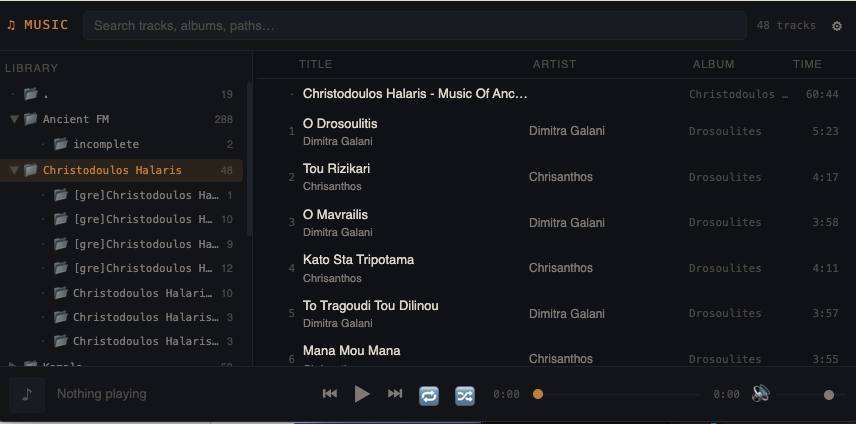

# HTML Music Gallery Creator

A Python script that generates a self-contained, zero-dependency HTML audio player from a local music library. Works directly from `file://` URLs — no server required.



## Features

### Player Interface
- **Dark-themed UI** with resizable sidebar for library navigation
- **Track list** with title, artist, album, etc
- **Album art** display in headers and now-playing bar (extracted from embedded tags or cover files)
- **Search** across tracks (title, artist, album, folder)
- **Playback controls**: play/pause, previous, next, seek scrubber, volume
- **Repeat modes**: off / all / one track
- **Shuffle** toggle for randomized playback
- **Queue management** via context menu (play next, add to queue, remove)

### Context Menus
Right-click tracks or folders to:
- Play / Play next / Add to queue
- Download / Copy file URL
- Play folder / Copy folder URL
- View track info (full metadata)

### Performance
- **IndexedDB caching** for libraries >300 tracks
- **Lazy rendering** (200 tracks per chunk)

### Settings
- Font size adjustment (click ⚙️)
- Reload data / Clear cache buttons
- Shuffle library

### Keyboard Shortcuts
- <kbd>Space</kbd> — Play/pause
- <kbd>N</kbd> / <kbd>P</kbd> — Next / Previous
- <kbd>F</kbd> — Focus search
- <kbd>←</kbd> / <kbd>→</kbd> — Seek -5s / +5s
- <kbd>↑</kbd> / <kbd>↓</kbd> — Volume up / down
- <kbd>Esc</kbd> — Close modals

## Usage

```bash
python mugal.py [ROOT] [options]
```

- `ROOT` defaults to current directory

### Options

```
-o, --output       Output folder for index.html + audiodata.js
--no-art           Skip album art extraction
--force-rescan     Ignore cached state
--exclude PATTERN    Glob pattern to exclude (repeatable)
--no-html          Only generate audiodata.js
--min-duration SEC Skip tracks shorter than SEC seconds
-v, --verbose      Print each scanned file
```

### Examples

```bash
# Scan current folder
python mugal.py

# Scan specific folder with exclusions
python mugal.py ~/Music --exclude '*.wav' --exclude 'Podcasts/*'

# Skip short tracks and output elsewhere
python mugal.py ~/Music --output ~/output --min-duration 30
```

## Output Files

- `index.html` — Self-contained player (no external dependencies)
- `audiodata.js` — JSON track data with cover art references

## Requirements

- **Python 3.9+**
- **[`mutagen`](https://github.com/quodlibet/mutagen)** (optional, for full metadata/tags): `pip install mutagen`

### Supported Audio Formats

`.mp3`, `.flac`, `.ogg`, `.opus`, `.m4a`, `.aac`, `.wav`, `.webm`

Without mutagen, title defaults to filename and tags are minimal.

## How It Works

1. Recursively finds all audio files in the root folder
2. Reads metadata (title, artist, album, year, genre, track/disc numbers, duration) from file tags using mutagen
3. Finds album cover art (cover.jpg, folder.png, etc. or embedded APIC/covr pictures)
4. Creates `audiodata.js` with JSON track data and `index.html` with embedded CSS/JS player